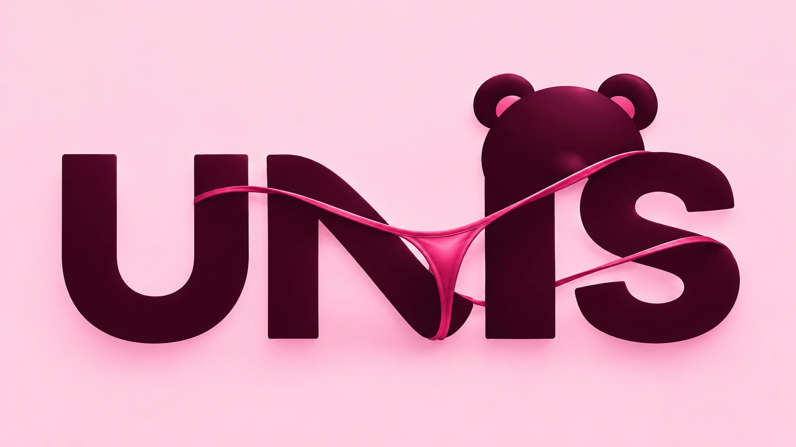

# UNIS : charte graphique

> Référence visuelle de la marque, pour les humains comme pour les IA (images, maquettes, code).
> Version du 16 novembre 2026 : **nouveau logo au string** et palette **bordeaux et rose**.
> En cas de doute sur le ton ou les limites, [CONTEXTE-IA.md](CONTEXTE-IA.md) fait foi.

---

## 1. Le logo

**L'idée :** le mot **UNIS** en grandes lettres bordeaux, épaisses et arrondies. **Un string framboise** se faufile à travers les lettres : la ficelle passe devant et derrière le N, le I et le S, et le triangle du string tombe entre le N et le I. On y lit tout de suite la marque : drôle (un string glissé dans le nom), sexy (le string), et confortable (des formes pleines et douces). Le fil rappelle aussi la signature : « Un fil. Tous les corps. »

### Fichiers

| Fichier | Usage |
| --- | --- |
| [`assets/logo/unis-logo-officiel.png`](assets/logo/unis-logo-officiel.png) | Logo officiel (1024 × 576 px, fond rose) : présentations, réseaux, impression, image de partage |
| [`assets/logo/unis-logo.svg`](assets/logo/unis-logo.svg) | Version vectorielle simplifiée, sans fond, redessinée pour le web |
| `src/art.mjs`, fonction `logoMark()` | Le même logo dans le code du site (en-tête et pied de page). Il prend la couleur du texte de la page et la couleur d'accent de la saison |
| [`src/static/favicon.svg`](src/static/favicon.svg) | Icône de l'onglet : le string framboise sur un carré bordeaux |
| `assets/images/og-unis.jpg` | Image de partage (1200 × 630), tirée du logo officiel |

### Règles d'usage

- **Couleurs autorisées :**
  - bordeaux sur rose (version principale) ;
  - rose pâle sur bordeaux (version inversée, pied de page) ;
  - sur une page de saison, l'encre et l'accent de la saison.
- **Zone de protection :** laisse autour du logo un espace libre au moins égal à la moitié de la hauteur d'une lettre.
- **Taille minimale :** 96 px de large à l'écran, 25 mm à l'impression. En plus petit, utilise seulement l'icône (le string sur carré bordeaux).
- **Interdit :**
  - déformer le logo ou changer sa police ;
  - retirer le string ou changer sa couleur ;
  - ajouter une ombre portée ou un contour ;
  - le poser sur une photo chargée ;
  - écrire « Uniss », « Unis. » ou toute autre variante.

---

## 2. Les couleurs

### Palette de marque (pages générales : accueil, compte, aide, journal, mentions…)

| Nom | Hex | Rôle | Variable CSS |
| --- | --- | --- | --- |
| **Bordeaux** | `#3E031B` | Lettres du logo, textes, boutons foncés, pied de page | `--ink` |
| **Framboise** | `#D42A6E` | Accent : bouton principal, string du logo, badges, liens forts | `--accent` |
| **Rose dragée** | `#FFE3EE` | Fond des pages | `--bg` |
| **Rose bonbon** | `#FAB8D0` | Fonds secondaires, cartes, surlignage | `--soft` |
| **Rose logo** | `#FDD2E3` | Fond du logo officiel, visuels réseaux sociaux | — |
| **Miel (Bo)** | `#C98B4B` | Le pelage de Bo : jamais pour du texte | — |
| **Blanc** | `#FFFFFF` | Texte sur Framboise, fonds du panier et des fenêtres | `--on-accent`, `--paper` |

**Contrastes vérifiés (WCAG AA, 4,5:1 minimum pour le texte) :**
- Bordeaux sur Rose dragée : **14,2:1**
- Bordeaux sur Rose logo : **12,6:1**
- Blanc sur Framboise : **4,8:1** (boutons)
- Framboise sur Rose dragée : **4,6:1** (texte d'accent, à utiliser avec parcimonie)
- **À éviter :** le texte Bordeaux sur fond Framboise (3,9:1).

Le site vérifie ces contrastes à chaque génération (`node src/build.mjs`).

### Palettes de saison (motifs, photos et réseaux sociaux)

Depuis le 16 novembre 2026, **toutes les pages du site, pages de drop comprises, sont en palette de marque** (rose et bordeaux). Les palettes de saison servent aux motifs des strings, aux photos, aux visuels réseaux et aux emails de la saison.

| Saison | Fond | Encre | Accent | Doux |
| --- | --- | --- | --- | --- |
| Saint-Valentin | `#FFE9EE` | `#3B0A1E` | `#E0234E` | `#FFB7C8` |
| Printemps | `#EEF6EC` | `#1E3324` | `#7A5BD8` | `#C9E7C1` |
| Pride | `#FFF7E0` | `#1B1B3A` | `#C42A60` | `#FFD66B` |
| Été | `#E3F4FF` | `#0C2D48` | `#FF6B2C` | `#8FD3FF` |
| Halloween | `#1C1726` | `#F3EEFF` | `#FF8A1F` | `#4A3A66` |
| Octobre Rose | `#FFF0F5` | `#4A1030` | `#C2185B` | `#F8BBD0` |
| Noël | `#FFE3EE` | `#3E031B` | `#C8372D` | `#FAB8D0` |

Les palettes sont définies dans `src/data.mjs` (`BASE` pour la marque, `SEASONS[].c` pour les saisons).

### Couleurs produit (Essentiels)

Les 6 couleurs des strings Essentiels restent inchangées : Encre `#1B1B3A`, Lilas `#C8B6FF`, Corail `#FF5A4E`, Sable `#D9C3A5`, Cacao `#5A3A2E`, Blanc `#F7F7F2`. Ce sont des couleurs de tissu, pas des couleurs d'interface.

---

## 3. Typographie

| Usage | Police | Réglages |
| --- | --- | --- |
| Titres, prix, logo | **Bricolage Grotesque** | Graisse 700 à 800, version étroite (`wdth` 75 à 80) pour les titres |
| Textes, boutons, formulaires | **Atkinson Hyperlegible** | 400 et 700, taille de base 17 px, interligne 1,55 |

- Titres courts, en minuscules avec une majuscule initiale (pas de texte tout en capitales, sauf le mot UNIS).
- 65 caractères maximum par ligne de texte.

---

## 4. Formes et composants

- **Arrondis :**
  - 28 px pour les cartes et les photos (`--r-big`) ;
  - 10 px pour les encadrés (`--r-small`) ;
  - pilule (999 px) pour les boutons, les sélecteurs et les badges.
- **Bouton principal :** fond Framboise, texte blanc, hauteur 52 px.
- **Bouton secondaire :** contour Bordeaux de 1,5 px, fond transparent.
- **Cibles tactiles :** 44 px minimum, focus clavier visible (contour de 3 px de la couleur d'encre).
- **Animations :** légères, et coupées si l'appareil demande moins d'animations (`prefers-reduced-motion`).

---

## 5. Photos et illustrations

- **Bo**, le héros :
  - ours en peluche miel `#C98B4B`, yeux boutons noirs, **sans sourcils** ;
  - un nœud à la couleur de la saison ;
  - image de référence : [`assets/reference/bo-reference.jpg`](assets/reference/bo-reference.jpg).
- **Fiches produits :** le string **posé à plat, vu du dessus, sur fond blanc**, en carré (1:1).
- **Ambiance :** fonds clairs, lumière douce, décors d'adultes (dîner entre amis, appartement, terrasse).
- **Formats web :** WebP de moins de 150 Ko, en 600 px et 1200 px de large, avec un texte alternatif dans les 4 langues.
- **Interdits :**
  - aucun enfant, ni décor ou objet d'enfant ;
  - aucun logo, marque ou personnage d'autrui ;
  - aucun texte généré par l'IA dans l'image ;
  - aucune pose explicite.
- Prompts prêts à l'emploi : [docs/13-prompts-visuels.md](docs/13-prompts-visuels.md) et [docs/14-prompts-27-images.md](docs/14-prompts-27-images.md). Dans ces prompts, remplace les anciennes couleurs (Encre `#1B1B3A`, Corail `#FF5A4E`, Lilas pâle `#EFEAFF`) par Bordeaux `#3E031B`, Framboise `#D42A6E` et Rose dragée `#FFE3EE`.

---

## 6. Application rapide

| Support | Fond | Logo | Accent |
| --- | --- | --- | --- |
| Site, pages générales | Rose dragée | Bordeaux + string Framboise | Framboise |
| Site, pages de drop | Rose dragée | Bordeaux + string Framboise | Framboise |
| Pied de page | Bordeaux | Rose dragée + string Framboise | — |
| Post Instagram | Rose logo `#FDD2E3` | Bordeaux | Framboise |
| Email (en-tête) | Rose dragée | Bordeaux | Bouton Framboise |
| Emballage (pochette kraft, boîte de Bo) | Kraft ou Rose dragée | Bordeaux | Autocollant Framboise |
